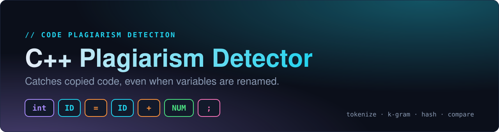
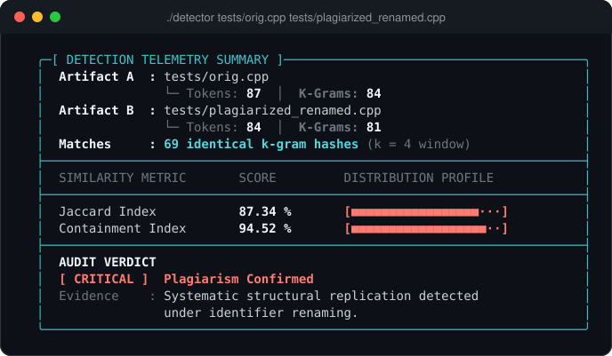
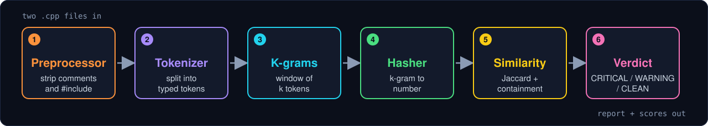
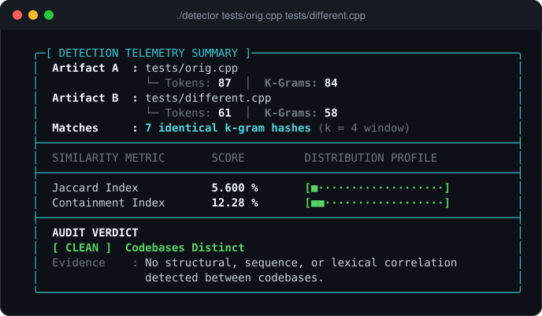
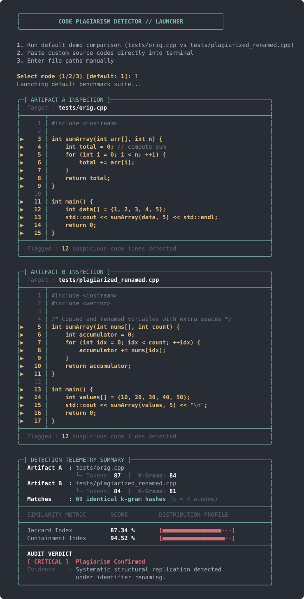

<div align="center">



<br/>


**Compare two C++ source files and find out whether one was copied from the other, even after variables are renamed, comments are rewritten and spacing is changed.**

[Quick start](#-quick-start) ·
[How it works](#-how-it-works) ·
[Usage](#-usage) ·
[Results](#-results) ·
[Sample output](#-sample-output) ·
[Project structure](#-project-structure) ·
[Limitations](#-limitations-and-roadmap)

</div>

---

## Why this exists

Comparing two programs as plain text is easy to fool. Renaming a variable, deleting a comment or adding a few spaces makes a copied program look completely different to a text diff, while the logic stays identical.

This tool compares the **structure** of the code instead of the text. It strips the cosmetic noise, turns the code into a stream of typed tokens, fingerprints overlapping groups of those tokens, and measures how many fingerprints the two files share.

```diff
- int total = 0; // compute sum              (original)
+ int accumulator = 0;                       (copy, renamed)

  both become  ->  int ID = NUM ;
```

<div align="center">

</div>

## ✨ Features

- **Rename-proof.** Identifiers, numbers and strings are normalized to `ID`, `NUM` and `STR`, so renaming variables does not hide a copy.
- **Ignores cosmetic edits.** Comments, `#include` / `#define` lines and extra whitespace are removed before comparison.
- **Two similarity metrics.** Jaccard index (overall overlap) and containment index (how much of the smaller file appears in the other).
- **Line-level evidence.** Every matching line is flagged in an annotated source view, so you can see exactly what overlaps.
- **Clear verdict.** `CRITICAL`, `WARNING` or `CLEAN`, based on documented thresholds.
- **Tunable.** Choose the k-gram size `k` from the command line.
- **Three ways to run.** Command-line arguments, an interactive menu, or paste code straight into the terminal.
- **Clean OOP design.** One class per pipeline stage, and the metrics share a common `SimilarityCalculator` interface.
- **Dependency-free.** Pure C++17 standard library, built with a single `make`.

## 🚀 Quick start

**Requirements:** a C++17 compiler (`g++` by default) and `make`. Developed and tested on Linux. macOS should work too (`make CXX=clang++`), and on Windows you can use WSL.

```bash
git clone https://github.com/Subu780/code-plagiarism-detector.git
cd code-plagiarism-detector
make
./detector tests/orig.cpp tests/plagiarized_renamed.cpp
```

You should see the annotated source views and the summary shown above. To remove build files, run `make clean`.

## 🧠 How it works

<div align="center">

</div>

| # | Stage | What it does | Source |
|---|-------|--------------|--------|
| 1 | **Preprocessor** | Removes `//` and `/* */` comments (string-aware), drops `#` directive lines, collapses whitespace. Newlines are kept so line numbers stay correct. | `Preprocessor.cpp` |
| 2 | **Tokenizer** | Scans the text into typed tokens: `KEYWORD`, `IDENTIFIER`, `NUMBER`, `STRING_LITERAL`, `OPERATOR`, `SYMBOL`. Then normalizes identifiers to `ID`, numbers to `NUM` and strings to `STR`. | `Tokenizer.cpp`, `Token.cpp` |
| 3 | **K-gram generator** | Slides a window of `k` tokens over the stream. `n` tokens give `n - k + 1` k-grams, joined with `_`. | `KGramGenerator.cpp` |
| 4 | **Hasher** | Turns each k-gram string into a number with a polynomial hash. | `Hasher.cpp` |
| 5 | **Similarity** | Compares the two hash sets with Jaccard and containment. | `JaccardSimilarity.cpp`, `ContainmentSimilarity.cpp` |
| 6 | **Report** | Flags matching lines, prints the summary and gives the verdict. | `ReportGenerator.cpp` |

<details>
<summary><b>Worked example: one line through the pipeline</b></summary>

<br/>

```text
Source line      int total = a + 5;

Tokens           [KEYWORD int] [IDENTIFIER total] [OPERATOR =] [IDENTIFIER a]
                 [OPERATOR +] [NUMBER 5] [SYMBOL ;]

Normalized       int  ID  =  ID  +  NUM  ;

k-grams (k = 4)  int_ID_=_ID      ->  358629188
                 ID_=_ID_+        ->  689875359
                 =_ID_+_NUM       ->  24200905
                 ID_+_NUM_;       ->  451886711
```

A copy written as `int sum = x + 9;` produces exactly the same k-grams and the same hashes.

</details>

<details>
<summary><b>The hash function</b></summary>

<br/>

For each character `ch` in the k-gram string:

```text
hash = (hash * 31337 + ch) mod 1,000,000,007
```

The same text always gives the same number, and different text gives a different number in almost every case (collisions are possible but rare).

</details>

### Similarity metrics

Both metrics work on the **sets of unique hashes** `A` and `B` from the two files, so a k-gram that repeats within a file counts once.

| Metric | Formula | Good at |
|--------|---------|---------|
| **Jaccard** | `\|A ∩ B\| / \|A ∪ B\|` | Overall overlap between two files |
| **Containment** | `\|A ∩ B\| / min(\|A\|, \|B\|)` | A small file copied into a larger one |

### Verdict thresholds

| Verdict | Condition | Meaning |
|---------|-----------|---------|
| 🔴 **CRITICAL** | Jaccard ≥ 75 % **or** Containment ≥ 80 % | Plagiarism confirmed |
| 🟡 **WARNING** | Jaccard ≥ 45 % **or** Containment ≥ 55 % | Suspicious overlap, review manually |
| 🟢 **CLEAN** | Below both | Codebases distinct |

## 🛠 Usage

### 1. Command line (fastest)

```bash
./detector <file1> <file2> [k]
```

```bash
./detector student_a.cpp student_b.cpp        # default k = 4
./detector student_a.cpp student_b.cpp 6      # stricter: longer matching sequences
```

### 2. Interactive menu

Run `./detector` with no arguments:

| Option | What it does |
|--------|--------------|
| `1` | Runs the built-in demo (`tests/orig.cpp` vs `tests/plagiarized_renamed.cpp`) |
| `2` | Lets you paste two programs into the terminal. Type `END` on its own line to finish each one |
| `3` | Asks for two file paths |

> Paste mode saves the snippets to `build/snippet_a.cpp` and `build/snippet_b.cpp`, so run `make` first, which creates the `build/` folder.

### Choosing `k`

`k` is the number of tokens in each fingerprint. Small `k` is forgiving but noisy. Large `k` is stricter and needs longer identical stretches to match. The default is **4**. Measured on the bundled test files:

| k | Renamed copy (Jaccard / Containment) | Different program (Jaccard / Containment) |
|---|--------------------------------------|-------------------------------------------|
| 2 | 96.15 % / 100.00 % | 27.27 % / 43.75 % |
| 3 | 90.14 % / 95.52 % | 11.81 % / 23.63 % |
| **4** | **87.34 % / 94.52 %** | **5.60 % / 12.28 %** |
| 6 | 82.55 % / 92.20 % | 2.26 % / 5.36 % |
| 8 | 82.55 % / 92.20 % | 0.75 % / 1.85 % |

As `k` grows, unrelated code drops towards zero quickly while the renamed copy stays high. `k = 4` keeps the copy clearly above the CRITICAL thresholds and the unrelated program far below them, so it is the default.

## 📊 Results

Both runs below use the default `k = 4`.

| Pair | Tokens | Matching hashes | Jaccard | Containment | Verdict |
|------|--------|-----------------|---------|-------------|---------|
| `orig.cpp` vs `plagiarized_renamed.cpp` | 87 / 84 | 69 | **87.34 %** | **94.52 %** | 🔴 CRITICAL |
| `orig.cpp` vs `different.cpp` | 87 / 61 | 7 | **5.60 %** | **12.28 %** | 🟢 CLEAN |

<div align="center">

</div>

### 🖥 Sample output

A complete run of the built-in demo (`./detector`, then option `1`). Lines marked with `▶` contain tokens from a matching k-gram, so you can see exactly what overlaps. The summary at the bottom gives the scores and the verdict.

<div align="center">

</div>

## 📁 Project structure

```text
code-plagiarism-detector/
├── assets/                     images used in this README
├── src/
│   ├── main.cpp                CLI entry point, menu and paste mode
│   ├── PlagiarismDetector.*    orchestrates the whole pipeline
│   ├── SourceFile.*            loads a file from disk
│   ├── Preprocessor.*          comment, directive and whitespace cleanup
│   ├── Token.*                 token type, text, line number, matched flag
│   ├── Tokenizer.*             text to normalized token stream
│   ├── KGramGenerator.*        sliding window of k tokens
│   ├── Hasher.*                polynomial string hash
│   ├── SimilarityCalculator.h  abstract interface for metrics
│   ├── JaccardSimilarity.*     Jaccard index
│   ├── ContainmentSimilarity.* containment index
│   └── ReportGenerator.*       annotated view, summary and verdict
├── tests/
│   ├── orig.cpp                original program
│   ├── plagiarized_renamed.cpp same logic, renamed variables
│   └── different.cpp           unrelated program
├── Makefile
├── LICENSE
└── README.md
```

### Design notes

- **One responsibility per class.** Each pipeline stage is its own class, so a stage can be changed without touching the others.
- **Polymorphic metrics.** `JaccardSimilarity` and `ContainmentSimilarity` both implement `SimilarityCalculator`. `PlagiarismDetector` holds them as `std::unique_ptr<SimilarityCalculator>`, so adding a new metric means adding one class.
- **Raw and normalized text.** Each `Token` keeps both its original text and its normalized value. Comparison uses the normalized value, and the report uses the original to show real code.
- **Modern C++.** C++17, RAII with smart pointers, `const` correctness, and builds clean with `-Wall -Wextra -pedantic`.

## ⚠️ Limitations and roadmap

**Known limitations**

- It detects structural copies. Heavy restructuring (reordering statements, replacing loops with different constructs) can lower the score.
- The tokenizer is a lightweight scanner, not a full C++ parser. `::` is read as two `:` tokens, and literal suffixes such as `1.5f` split into a number plus an identifier. Both files are treated the same way, so scores stay consistent.
- Hashes are reduced modulo 1,000,000,007, so collisions are possible but very unlikely at this scale.
- The summary banner always prints `(k = 4 window)`, even if a different `k` was passed on the command line.
- Paste mode relies on `/dev/tty`, so it needs a Unix-style terminal (Linux, macOS or WSL).

**Roadmap**

- [ ] Compare a whole folder of submissions and print a ranked summary table (`ReportGenerator::printSummary` is already stubbed for this)
- [ ] Print the real `k` in the report banner
- [ ] Optional JSON output for scripting
- [ ] Unit tests for each stage
- [ ] CMake support
- [ ] Windows-friendly input mode

## 📄 License

Released under the [MIT License](LICENSE).

## 👤 Author

**Subhranshu Kumar Mishra**, IIIT Bhubaneswar